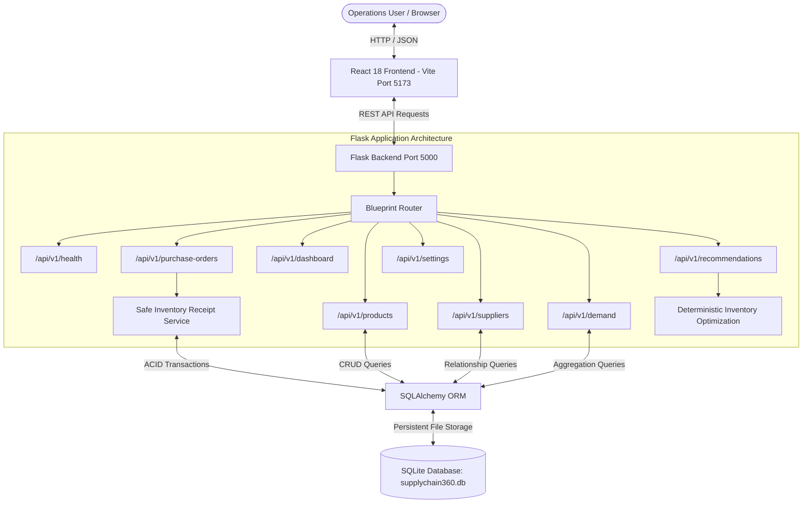
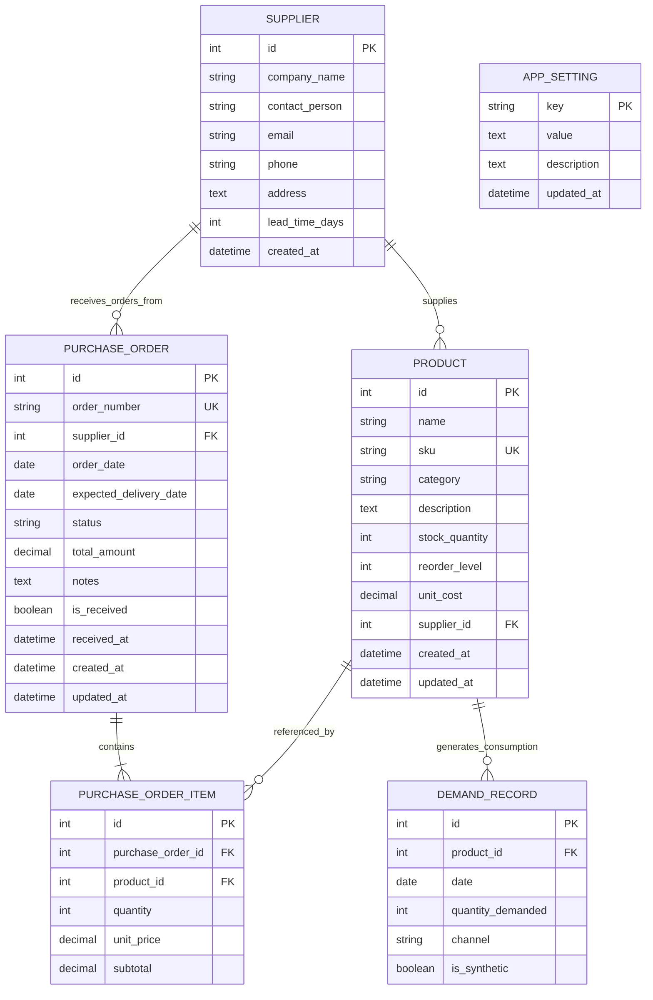
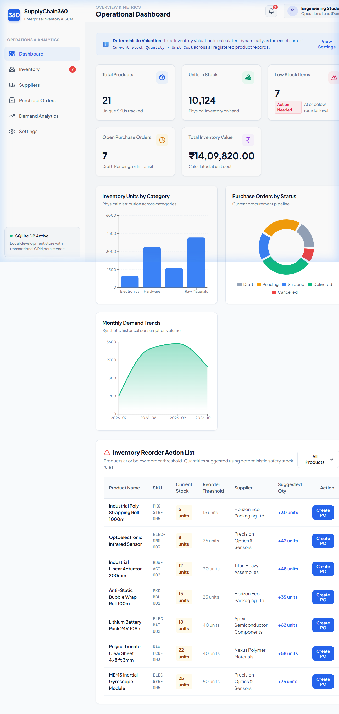
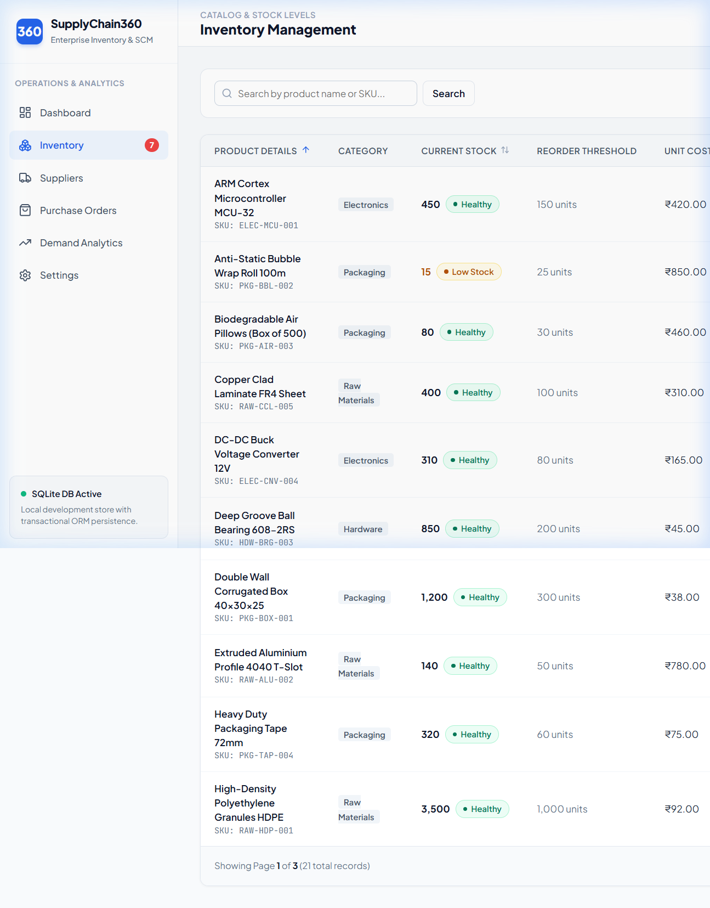
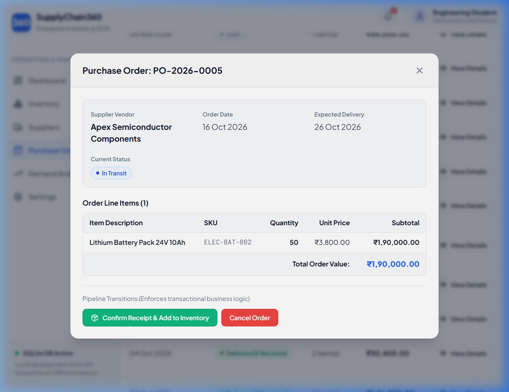
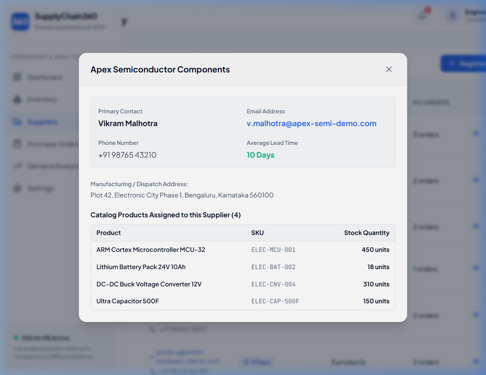
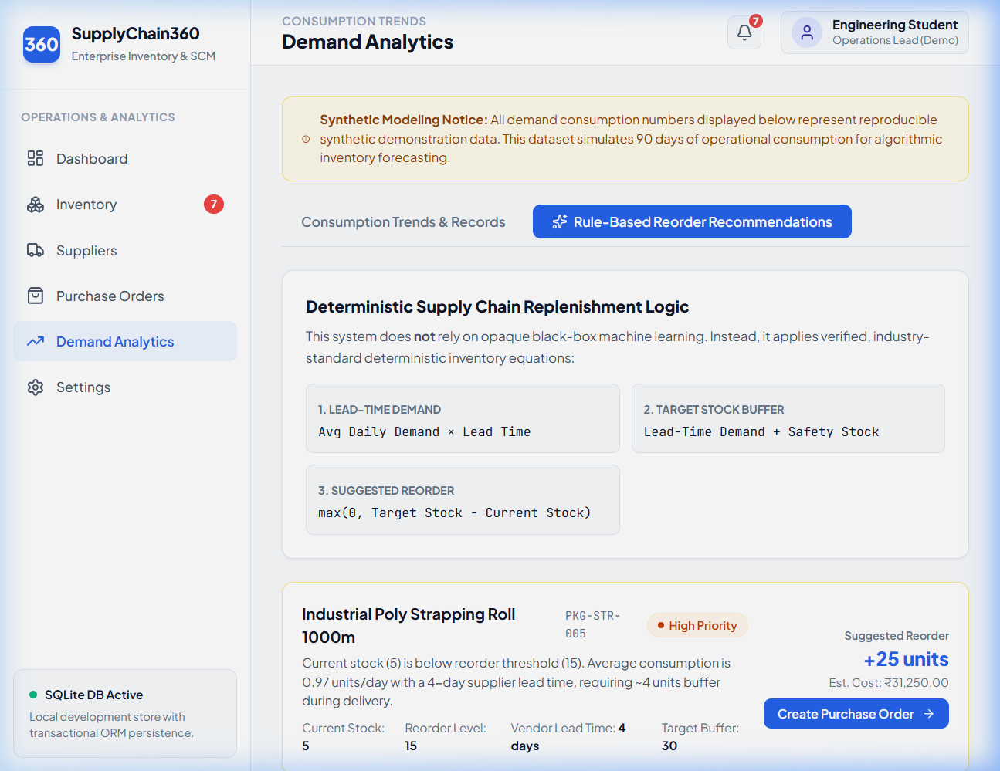
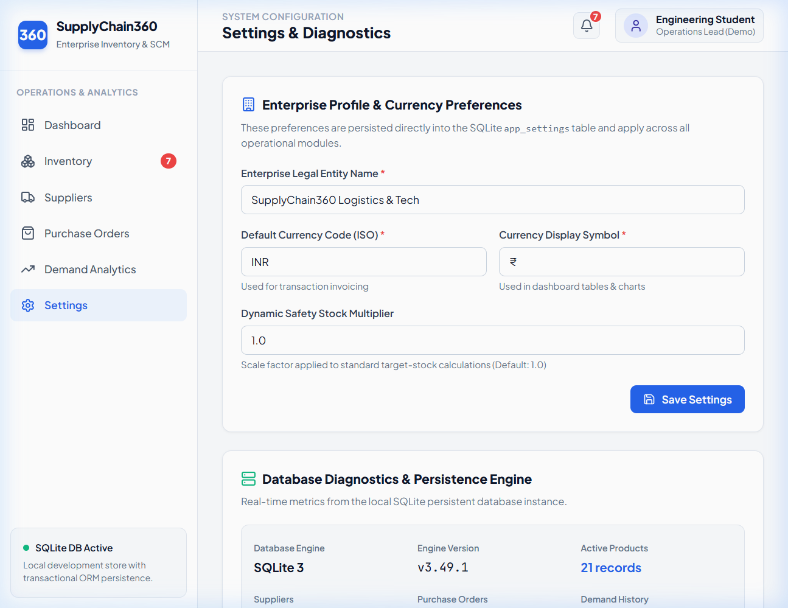

# SupplyChain360 - Enterprise Supply Chain Management & Demand Analytics

[](https://www.python.org/)
[](https://flask.palletsprojects.com/)
[](https://react.dev/)
[](https://vitejs.dev/)
[](https://www.sqlite.org/)
[](https://pytest.org/)

SupplyChain360 is a full-stack, database-backed supply chain management and demand analytics platform designed for modern manufacturing, hardware engineering, and distribution enterprises. Built with a **React 18** frontend, a **Python Flask 3** REST API backend, and an ACID-compliant **SQLite / SQLAlchemy ORM** persistence layer.

---

## 1. Problem Statement

Small to mid-sized hardware and electronics manufacturing operations frequently struggle with disconnected inventory tracking spreadsheets and uncoordinated procurement orders:
- **Stockouts and Assembly Delays**: Critical fasteners or microcontrollers run out without warning because reorder thresholds are not calculated against supplier lead times.
- **Accidental Double-Counting**: When shipments arrive, inventory is frequently added twice due to manual spreadsheet edits or non-transactional order status updates.
- **Disconnected Financial Valuation**: Book values of inventory diverge from actual physical counts and unit procurement costs.
- **Opaque Forecasting**: Off-the-shelf "AI predictions" give black-box numbers without explaining why an order is needed or what buffer formula was used.

**SupplyChain360 solves these problems** by providing a unified, explainable, and transactional system where purchase order receipts atomically update physical inventory exactly once, demand analytics are transparently calculated, and reorder alerts follow explainable deterministic replenishment formulas.

---

## 2. Key Features

- **Live Operational Dashboard**:
  - Dynamic KPI cards: Total Products, Units in Stock, Low-Stock Count, Open Orders, and Total Inventory Valuation.
  - Interactive Recharts data visualizations: Category Volume distribution (Bar Chart), Procurement Status breakdown (Donut/Pie Chart), and Monthly Demand Velocity (Area Chart).
  - Priority Action Table highlighting products below threshold with one-click purchase order generation.
- **Comprehensive Inventory Management**:
  - Full CRUD operations with instant frontend and backend validation.
  - Unique SKU enforcement and non-negative constraints on stock and pricing.
  - Safe deletion restrictions preventing deletion of products with purchase history.
  - Search by name or SKU, filter by category and stock level, and sort by valuation.
- **Supplier Directory & Partner Management**:
  - Vendor directory with contact person, email, phone, and delivery lead time (days).
  - Supplier profile modal displaying all assigned catalog items.
  - Safe deletion checks preventing removal of suppliers with linked catalog items or open orders.
- **Atomic Purchase Order Lifecycle & Safe Receipt Engine**:
  - Multi-line item purchase order creation with automatic subtotal and total calculations.
  - Enforced lifecycle state machine: `draft` ➔ `pending` ➔ `shipped` ➔ `delivered` (or `cancelled`).
  - **Critical Inventory Receipt Rule**: Creating drafts, updating to pending, or shipping orders **never** modifies stock. When an order is delivered and received, stock quantities are incremented **atomically within a database transaction**.
  - **Idempotency & Duplicate Guard**: Repeated receipt calls return HTTP 409 Conflict, permanently preventing accidental double-counting.
- **Demand Analytics & Consumption Modeling**:
  - 90 days of reproducible synthetic daily demand across multiple channels (Direct B2B, Online Portal, Contract Fulfillment).
  - Date-range and product-level filtering with downloadable CSV reports.
- **Explainable Rule-Based Reorder Recommendations**:
  - Transparent classical replenishment formulas: `Lead Time Demand = Avg Daily Demand × Supplier Lead Time`, `Target Stock = Lead Time Demand + Safety Stock`, `Suggested Order = max(0, Target Stock − Current Stock)`.
  - Transparent urgency classification (`CRITICAL`, `HIGH`, `MEDIUM`, `HEALTHY`) with one-click purchase order prefilling.
- **System Settings & Database Diagnostics**:
  - Configurable business legal name, ISO currency code, and currency symbol (`₹`, `$`, `€`).
  - Real-time SQLite diagnostics (version, active record counts).
  - Destructive demo data reset protected by explicit confirmation.

---

## 3. Technology Stack

### Frontend
- **Framework**: React 18 with Vite 6
- **Routing**: React Router DOM 6
- **Charts & Data Viz**: Recharts 2
- **Icons**: Lucide React
- **Styling**: Vanilla CSS3 design system with custom CSS variables, accessible labels, responsive grids, and focus states.
- **Networking**: Fetch API with centralized error interception.

### Backend
- **Language**: Python 3.13+
- **Framework**: Flask 3.1
- **Cross-Origin**: Flask-CORS 6.0
- **Database ORM**: Flask-SQLAlchemy 3.1 / SQLAlchemy 2.1
- **Testing**: Pytest 9.1 with in-memory SQLite fixtures
- **Architecture**: Application Factory (`create_app`), modular Blueprints, and RESTful JSON endpoints.

### Database
- **Storage**: SQLite 3 (stored locally in `backend/instance/supplychain360.db`)
- **Integrity**: Foreign keys, unique constraints, and transaction rollbacks on failure.

---

## 4. Architecture Overview

### Data Flow Diagram



### How a User Action Travels Through the Stack

1. **User Interaction**: The user clicks "Confirm Receipt & Add to Inventory" on a shipped purchase order in the React UI.
2. **API Client (`api.js`)**: React sends a `POST /api/v1/purchase-orders/:id/receive` HTTP request with JSON headers.
3. **Flask Route (`purchase_orders.py`)**: The blueprint intercepts the route, retrieves the order record, and validates that `is_received` is false and status is not `cancelled`.
4. **Business Logic & Transaction**:
   - Inside an atomic database transaction (`db.session.begin()`), the backend iterates over all line items.
   - For each item, it looks up the `Product` model and increments `stock_quantity += item.quantity`.
   - Sets `order.is_received = True`, `order.status = 'delivered'`, and `order.received_at = datetime.utcnow()`.
   - `db.session.commit()` writes the changes to SQLite. If any line item errors, `db.session.rollback()` ensures no inventory is partially updated.
5. **Response & UI Refresh**: Flask returns HTTP 200 with the updated order and product stock counts. React updates its component state, clears modals, and displays a green notification banner without requiring a full-page browser reload.

---

## 5. Database Schema & Relationships



---

## 6. Real Application Screenshots

The following screenshots were captured directly from the live running application:

### 1. Operational Dashboard

*Live dashboard showing KPI summary cards, Category Distribution Bar Chart, Purchase Orders Status Pie Chart, Demand Trends Area Chart, and Low-Stock Action Table.*

### 2. Inventory Management & Catalog

*Catalog table displaying SKUs, categories, current stock, reorder thresholds, inventory valuation, and modal editing controls.*

### 3. Purchase Order Inspection & Safe Receipt Modal

*Purchase order view showing line items, unit prices, supplier lead times, and status transitions with duplicate receipt protection.*

### 4. Supplier Profile & Assigned Catalog

*Vendor supplier inspection modal displaying fulfillment lead times, contact details, and all catalog products supplied.*

### 5. Rule-Based Reorder Recommendations

*Explainable deterministic inventory recommendations detailing lead-time demand, target stock buffers, urgency badges, and quick PO generation.*

### 6. System Settings & SQLite Diagnostics

*Enterprise preferences and live database engine diagnostics showing active record counts and safe demo reset controls.*

---

## 7. RESTful API Contract

All endpoints are versioned under `/api/v1` and return standard JSON payloads.

| Method | Endpoint | Description |
| :--- | :--- | :--- |
| `GET` | `/api/v1/health` | System health check and uptime timestamp |
| `GET` | `/api/v1/dashboard/summary` | Aggregate KPI counts and total inventory valuation |
| `GET` | `/api/v1/dashboard/inventory-by-category` | Stock counts and valuations grouped by category |
| `GET` | `/api/v1/dashboard/orders-by-status` | Purchase order distribution grouped by status |
| `GET` | `/api/v1/dashboard/monthly-demand` | Time-series demand volume for chart rendering |
| `GET` | `/api/v1/dashboard/low-stock` | Products at or below reorder threshold |
| `GET` | `/api/v1/products` | Paginated product list with search, category & stock filters |
| `GET` | `/api/v1/products/:id` | Retrieve single product details |
| `POST`| `/api/v1/products` | Create product with validation & unique SKU check |
| `PUT` | `/api/v1/products/:id` | Update product details |
| `DELETE`| `/api/v1/products/:id`| Safely delete product (blocked if referenced in orders) |
| `GET` | `/api/v1/suppliers` | List vendor suppliers with search and pagination |
| `GET` | `/api/v1/suppliers/:id` | Retrieve supplier profile and assigned products list |
| `POST`| `/api/v1/suppliers` | Register new supplier with email validation |
| `PUT` | `/api/v1/suppliers/:id` | Update supplier information |
| `DELETE`| `/api/v1/suppliers/:id`| Safely delete supplier (blocked if catalog products exist) |
| `GET` | `/api/v1/purchase-orders` | List purchase orders with search and status filter |
| `GET` | `/api/v1/purchase-orders/:id`| Inspect purchase order with all product line items |
| `POST`| `/api/v1/purchase-orders` | Create purchase order with multi-product line items |
| `PATCH`| `/api/v1/purchase-orders/:id/status`| Transition order status adhering to state machine |
| `POST`| `/api/v1/purchase-orders/:id/receive`| **Atomic Inventory Receipt**: increments stock exactly once |
| `GET` | `/api/v1/demand` | Paginated demand records with date range filters |
| `GET` | `/api/v1/demand/summary` | Demand totals, daily consumption rate, and top 5 items |
| `GET` | `/api/v1/demand/trends` | Time-series aggregated demand |
| `GET` | `/api/v1/demand/export` | Export filtered demand records as standard CSV |
| `GET` | `/api/v1/recommendations/reorder` | Rule-based lead-time reorder recommendations |
| `GET` | `/api/v1/settings` | Retrieve application preferences & SQLite diagnostics |
| `PUT` | `/api/v1/settings` | Update enterprise legal name, currency, and safety multiplier |
| `POST`| `/api/v1/settings/reset` | Safe demonstration data reset (requires confirmation payload) |

---

## 8. Prerequisites & Local Installation

### Prerequisites
- **Node.js**: v18.0+ or v20.0+ (Tested on Node v22.15.0)
- **Python**: v3.10+ (Tested on Python 3.13.3)
- **Git**: Installed and accessible in your shell
- **Operating System**: Windows 10/11, macOS, or Linux (Lightweight: runs comfortably on 8 GB RAM)

### Step 1: Clone Repository
```bash
git clone https://github.com/your-username/SupplyChain360.git
cd SupplyChain360
```

### Step 2: Backend Setup (Python Flask)
1. Open PowerShell / Command Prompt and navigate to `backend`:
   ```powershell
   cd backend
   ```
2. Create and activate a Python virtual environment:
   ```powershell
   python -m venv venv
   .\venv\Scripts\Activate.ps1
   # If script execution is restricted on Windows PowerShell, run:
   # Set-ExecutionPolicy -Scope Process -ExecutionPolicy Bypass
   ```
3. Install backend dependencies:
   ```powershell
   pip install -r requirements.txt
   ```
4. Initialize SQLite database and seed demonstration data:
   ```powershell
   python seed.py
   ```
5. Start Flask development server on port 5000:
   ```powershell
   python run.py
   ```
   *The Flask API is now live at `http://127.0.0.1:5000`.*

### Step 3: Frontend Setup (React Vite)
1. Open a new terminal window and navigate to `frontend`:
   ```powershell
   cd frontend
   ```
2. Install frontend dependencies (use `npm.cmd` on Windows if PowerShell blocks `.ps1` scripts):
   ```powershell
   npm.cmd install
   ```
3. Start the Vite development server on port 5173:
   ```powershell
   npm.cmd run dev
   ```
4. Open your browser and navigate to:
   ```
   http://127.0.0.1:5173
   ```

---

## 9. Automated Testing

SupplyChain360 includes a comprehensive test suite running against an isolated SQLite in-memory database.

To run the automated tests:
```powershell
cd backend
.\venv\Scripts\pytest.exe -v
```

### Test Coverage Highlights
- `test_health.py`: Validates API health check response and timestamp.
- `test_products.py`: Tests product creation, duplicate SKU rejection, validation of negative values, stock updates, and referential integrity deletion restrictions.
- `test_suppliers.py`: Tests supplier registration, email format regex validation, and deletion blocking when catalog products are assigned.
- `test_inventory_receipt.py`: **Verifies mandatory business rules**:
  - Draft creation does NOT increment stock.
  - Transition to Shipped does NOT increment stock.
  - Delivery receipt increments stock by exact order quantity.
  - Duplicate receipt requests return **HTTP 409 Conflict** and do NOT duplicate stock.
  - Cancelled orders can NEVER be received into inventory.
  - Illegal status transitions are rejected with **HTTP 400 Bad Request**.
- `test_dashboard.py`: Verifies dynamic inventory valuation math (`stock_quantity × unit_cost`).
- `test_recommendations.py`: Tests lead-time demand calculations and urgency classifications.

---

## 10. Demonstration Workflows for Interviews

### Workflow 1: Inspecting Low-Stock Items & Creating a Purchase Order
1. Open the **Dashboard** (`/`). Notice the "Inventory Reorder Action List" highlighting products with low stock (e.g., *Lithium Battery Pack 24V*).
2. Click **Create PO** on the item row.
3. The app redirects to **Purchase Orders** and pre-fills the modal with the supplier, product, and recommended reorder quantity.
4. Select status `Draft` or `Pending` and click **Generate Purchase Order**.
5. Inspect the inventory table: Notice that physical stock has **not** increased, ensuring accounting accuracy.

### Workflow 2: Safe Atomic Inventory Receipt
1. Open **Purchase Orders** (`/purchase-orders`). Locate order `PO-2026-0005` (Status: *In Transit*).
2. Click **View Details**.
3. Click the green button: **Confirm Receipt & Add to Inventory**.
4. The system executes an atomic transaction, changes the order to `Delivered & Received`, records the exact receipt timestamp, and updates product stock in the database.
5. Attempting to click receipt again is prevented, guaranteeing that stock cannot be accidentally doubled.

### Workflow 3: Analyzing Demand Velocity & CSV Export
1. Open **Demand Analytics** (`/demand`).
2. Filter by product or date range. Review the consumption velocity chart.
3. Click **Export Filtered CSV** to download a clean, structured spreadsheet file for audit reporting.

---

## 11. Known Limitations & Planned Enhancements

| Feature Area | Current Status (Implemented) | Future Roadmap (Planned) |
| :--- | :--- | :--- |
| **Authentication** | Demo role profile placeholder without passwords | JWT multi-tenant authentication with role-based permissions (Admin, Warehouse Clerk, Purchasing Officer) |
| **Database** | Lightweight local SQLite with transactions | PostgreSQL support for enterprise multi-region concurrency |
| **Notifications** | Live UI banner alerts and topbar notification flyout | Automated email / webhook alerts via SendGrid / Slack when stock drops below threshold |
| **Barcode Scanning** | Manual SKU entry and search | Camera / barcode scanning support for mobile warehouse receiving |
| **Multi-Location** | Single centralized warehouse tracking | Multi-warehouse inventory transfers and bin-location tracking |

---

## 12. Git & GitHub Upload Instructions

To upload this repository to your personal GitHub account:

1. Create a new empty repository on GitHub named `SupplyChain360` (do not initialize with README, as we already have one).
2. In your local project directory, initialize Git and commit:
   ```powershell
   cd C:\Users\Admin\.gemini\antigravity-ide\scratch\SupplyChain360
   git init
   git add .
   git commit -m "feat: complete initial SupplyChain360 full-stack implementation"
   ```
3. Set your default branch to `main` and link to GitHub:
   ```powershell
   git branch -M main
   git remote add origin https://github.com/<YOUR_GITHUB_USERNAME>/SupplyChain360.git
   git push -u origin main
   ```

---

## 13. License & Academic Attribution

This project is created by a final-year engineering student as a capstone portfolio project demonstrating full-stack engineering, database normalization, REST API design, and supply chain inventory replenishment modeling.

Licensed under the [MIT License](LICENSE).
