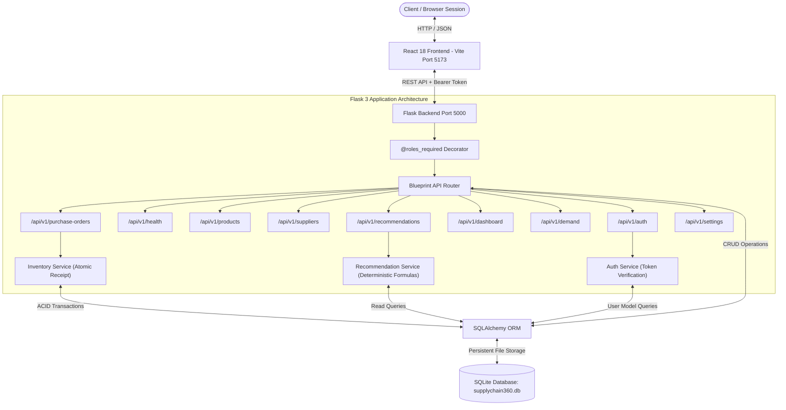
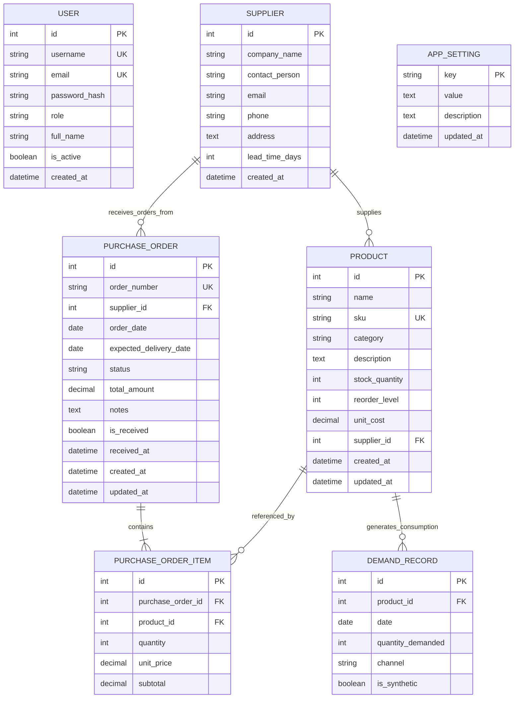
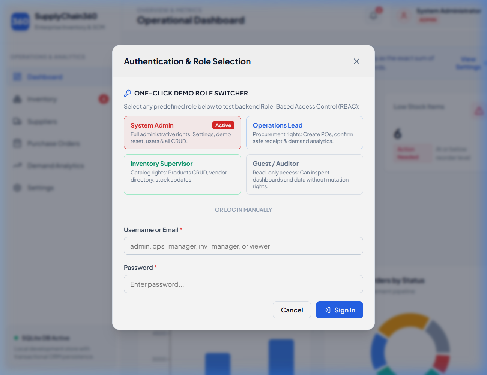
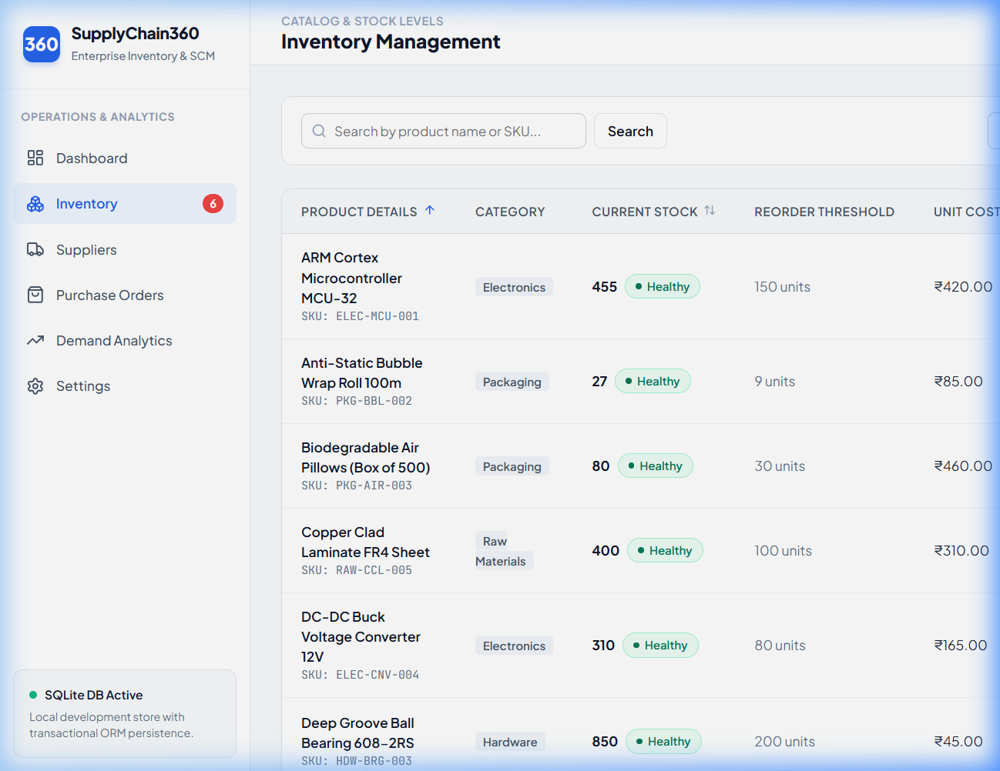
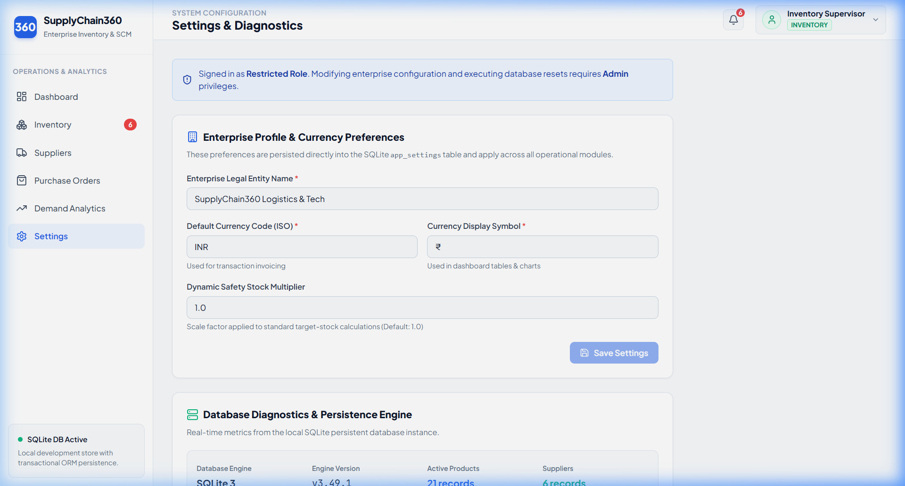

# SupplyChain360 - Enterprise Supply Chain Management & Demand Analytics

[](https://www.python.org/)
[](https://flask.palletsprojects.com/)
[](https://react.dev/)
[](https://vitejs.dev/)
[](https://www.sqlite.org/)
[](https://pytest.org/)
[](LICENSE)

SupplyChain360 is an enterprise-grade, portfolio-ready full-stack supply chain management, procurement lifecycle, and demand analytics platform designed for modern manufacturing, hardware engineering, and distribution enterprises. Built with a high-performance **React 18 (Vite 6)** frontend, a **Python 3.13 Flask 3** REST API backend, and an ACID-compliant **SQLite / SQLAlchemy ORM** persistence layer.

Featuring a production-quality **Authentication & 4-Tier Role-Based Access Control (RBAC)** architecture, transactional inventory receipt guards against double-counting, deterministic replenishment modeling, and a seamless 1-click interactive demo role switcher.

---

## 1. Problem Statement & Architecture Goals

Small to mid-sized hardware and electronics manufacturing operations frequently struggle with disconnected inventory tracking spreadsheets and uncoordinated procurement orders:
- **Stockouts and Assembly Line Halts**: Critical fasteners or microcontrollers run out without warning because reorder thresholds are not calculated against supplier lead times.
- **Accidental Double-Counting**: When shipments arrive, inventory is frequently added twice due to manual spreadsheet edits or non-transactional order status updates.
- **Disconnected Financial Valuation**: Book values of inventory diverge from actual physical counts and unit procurement costs.
- **Opaque Forecasting**: Off-the-shelf "AI predictions" give black-box numbers without explaining why an order is needed or what buffer formula was used.
- **Unauthorized Actions**: Without role-based access control, any user can accidentally alter global business settings, wipe databases, or place unauthorized purchase orders.

**SupplyChain360 solves these problems** by providing a unified, explainable, and transactional system where purchase order receipts atomically update physical inventory exactly once, demand analytics are transparently calculated, reorder alerts follow explainable replenishment formulas, and backend-enforced RBAC ensures strict principle of least privilege.

---

## 2. Key Features

### 🛡️ Authentication & Role-Based Access Control (RBAC)
- **PBKDF2 Password Hashing**: Passwords stored using `werkzeug.security` (PBKDF2-SHA256, 600,000 rounds).
- **HMAC-SHA256 Signed Bearer Tokens**: Stateless session tokens containing expiry, user ID, username, and role, verified cryptographically on every protected request.
- **Backend Route Guards**: `@roles_required(*roles)` Python decorator strictly validates permissions in Flask controllers, returning `HTTP 401 Unauthorized` or `HTTP 403 Forbidden`.
- **4 Distinct Operational Roles**:
  - 👑 **System Administrator (`admin`)**: Unrestricted access, global system settings, enterprise legal profile, currency preferences, and demo reset controls.
  - 📦 **Operations Manager (`operations_manager`)**: Purchase order lifecycle, status pipeline transitions, atomic inventory receipts, and demand analytics.
  - 🏷️ **Inventory Manager (`inventory_manager`)**: Product catalog management, unique SKU registration, unit costs, vendor directory, and safety stock reorder levels.
  - 👁️ **Auditor / Read-Only Viewer (`viewer`)**: Safe read-only inspection across all modules without mutation permissions.
- **Interactive 1-Click Demo Switcher**: Instant role switching in the Topbar to demonstrate real-time permission toggling in placement and technical interviews.

### 📊 Live Operational Dashboard
- **Dynamic KPI Summary Cards**: Total Catalog Products, Units in Stock, Low-Stock Count, Open Orders, and Estimated Total Valuation.
- **Interactive Recharts Data Visualizations**:
  - Category Volume distribution (Bar Chart).
  - Purchase Orders Status breakdown (Donut/Pie Chart).
  - Monthly Demand Velocity trend (Smooth Area Chart).
- **Low-Stock Priority Action Table**: Real-time alerts for products below safety buffer with one-click purchase order generation.

### 📦 Robust Inventory & Catalog Management
- **Full Catalog Lifecycle**: Add, edit, search, filter, and sort products with pagination.
- **Strict Business Validation**: Unique SKU enforcement, rejection of negative stock, reorder thresholds, and unit costs.
- **Safe Referential Integrity**: Cascading checks prevent accidental deletion of products linked to historical purchase orders or demand history.
- **Real-Time Inventory Valuation**: Dynamically computed from physical stock and unit cost (`stock_quantity × unit_cost`).

### 🏭 Supplier Directory & Vendor Management
- **Vendor Profiles**: Company name, contact person, verified email format, phone, address, and delivery lead time (days).
- **Supplier Inspection Modal**: View all active catalog products supplied by a specific vendor.
- **Referential Deletion Protection**: Blocks deletion of suppliers that currently have active products in the catalog.

### 🔄 Atomic Purchase Order Lifecycle & Safe Receipt Engine
- **Multi-Line Item Ordering**: Automatically aggregates subtotals and calculates order total amounts.
- **Strict State Machine**: Enforces valid transitions (`draft` ➔ `pending` ➔ `shipped` ➔ `delivered` or `cancelled`).
- **Atomic Receipt Guarantee**: Order drafting and shipping **never** modify inventory. When an order is received (`delivered`), stock quantities are incremented **atomically inside a database transaction** (`db.session.begin()`).
- **Duplicate Receipt Prevention**: Repeated receipt requests are rejected with **HTTP 409 Conflict**, permanently preventing accidental double-counting.
- **Concurrency & Concurrency Protection**: Atomic updates ensure consistency even under rapid user actions.

### 📈 Demand Analytics & Consumption Modeling
- **90-Day Consumption History**: Clean, reproducible daily consumption patterns across B2B Direct, Online Portal, and Contract Fulfillment channels.
- **Multi-Dimensional Filters**: Filter consumption history by product and custom date ranges.
- **CSV Audit Export**: One-click download of filtered consumption logs.

### 🎯 Explainable Rule-Based Reorder Recommendations
- **Classical Deterministic Formulation**:
  1. $\text{Lead-Time Demand} = \text{Average Daily Demand} \times \text{Vendor Lead Time (Days)}$
  2. $\text{Target Safety Buffer} = \text{Lead-Time Demand} + (\text{Reorder Level} \times \text{Safety Multiplier})$
  3. $\text{Suggested Reorder Quantity} = \max(0, \text{Target Safety Buffer} - \text{Current Stock})$
- **Zero Black-Box AI**: Transparent reasoning displayed on every recommendation card with urgency badges (`CRITICAL`, `HIGH`, `MEDIUM`, `HEALTHY`) and one-click purchase order prefilling.

---

## 3. Technology Stack

| Layer | Technologies | Rationale |
| :--- | :--- | :--- |
| **Frontend Framework** | React 18.3, Vite 6.0 | Fast HMR, component reusability, and small bundle footprint |
| **Routing & Navigation** | React Router DOM 6.28 | Client-side routing with clean URL parameters |
| **Data Visualization** | Recharts 2.15 | Responsive SVG charts (Bar, Area, Pie) |
| **UI Icons** | Lucide React | Modern, lightweight, accessible feather icons |
| **Styling & Design System** | Vanilla CSS3 Variables | Full layout control, 0 runtime CSS-in-JS overhead |
| **Backend Framework** | Python 3.13+, Flask 3.1 | Clean REST API design, lightweight footprint |
| **Database & ORM** | SQLite 3, SQLAlchemy 2.1, Flask-SQLAlchemy 3.1 | ACID transactions, foreign keys, and zero-config deployment |
| **Security & Auth** | Werkzeug Security, HMAC-SHA256 | PBKDF2 password hashing and signed Bearer token sessions |
| **Testing Suite** | Pytest 9.1 | Fast automated tests with in-memory SQLite fixtures |

---

## 4. Architecture & Data Flow



---

## 5. Database Schema & Relationships



---

## 6. Real Application Screenshots

The following screenshots were captured directly from the live running application:

### 1. Operational Dashboard

*Live dashboard showing KPI summary cards, Category Distribution Bar Chart, Purchase Orders Status Pie Chart, Demand Trends Area Chart, and Low-Stock Priority Action Table.*

### 2. 1-Click Interactive Role Switcher & Authentication Modal

*Topbar authentication modal with 1-click demo role switching between System Administrator, Operations Manager, Inventory Manager, and Viewer.*

### 3. Inventory Management (Auditor / Read-Only Viewer Mode)

*Demonstration of Role-Based Access Control in action: '+ Add Product' button is disabled, and table actions are locked into 'Read-only' mode for viewers.*

### 4. Inventory Catalog (Administrator / Manager Mode)

*Active catalog table displaying SKUs, categories, current stock, reorder thresholds, inventory valuation, and full modal editing controls.*

### 5. Purchase Order Inspection & Safe Receipt Modal

*Purchase order view showing line items, unit prices, supplier lead times, and pipeline transitions with duplicate receipt protection.*

### 6. Supplier Profile & Assigned Catalog

*Vendor supplier inspection modal displaying fulfillment lead times, contact details, and all catalog products supplied.*

### 7. Rule-Based Reorder Recommendations

*Explainable deterministic inventory recommendations detailing lead-time demand, target stock buffers, urgency badges, and quick PO generation.*

### 8. System Settings & Non-Admin Permission Guard Banner

*Role-based protection on enterprise settings: Non-admin users are presented with an informational banner, and save/reset buttons are locked.*

---

## 7. Demo Accounts & Credentials

SupplyChain360 includes 4 pre-configured demo accounts for portfolio walkthroughs and technical interviews:

| Username | Password | Role | Permitted Actions |
| :--- | :--- | :--- | :--- |
| **`admin`** | `Password123` | `admin` | Full system access, enterprise configuration, database reset, user management. |
| **`ops_manager`** | `Password123` | `operations_manager` | Create & transition purchase orders, atomic inventory receipt, view demand analytics. |
| **`inv_manager`** | `Password123` | `inventory_manager` | Create & update products, manage suppliers, adjust reorder thresholds. |
| **`viewer`** | `Password123` | `viewer` | Read-only inspection across all modules without mutation permissions. |

---

## 8. RESTful API Contract

All endpoints are versioned under `/api/v1` and return standard JSON payloads.

| Method | Endpoint | Access Control | Description |
| :--- | :--- | :--- | :--- |
| `POST` | `/api/v1/auth/login` | Public | Authenticate with credentials and receive Bearer token |
| `POST` | `/api/v1/auth/logout` | Public | Client-side session termination (returns 200 OK; token is cleared by client) |
| `GET` | `/api/v1/auth/me` | Authenticated (Any Role) | Return current authenticated user profile |
| `GET` | `/api/v1/auth/demo-users`| Public | List pre-configured demo accounts for UI switcher |
| `GET` | `/api/v1/health` | Public | System health check and uptime timestamp |
| `GET` | `/api/v1/dashboard/summary` | Public | Aggregate KPI counts and total inventory valuation |
| `GET` | `/api/v1/dashboard/inventory-by-category` | Public | Stock counts and valuations grouped by category |
| `GET` | `/api/v1/dashboard/orders-by-status` | Public | Purchase order distribution grouped by status |
| `GET` | `/api/v1/dashboard/monthly-demand` | Public | Time-series demand volume for chart rendering |
| `GET` | `/api/v1/dashboard/low-stock` | Public | Products at or below reorder threshold |
| `GET` | `/api/v1/products` | Public | Paginated product list with search, category & stock filters |
| `GET` | `/api/v1/products/:id` | Public | Retrieve single product details |
| `POST` | `/api/v1/products` | `admin`, `inventory_manager` | Create product with validation & unique SKU check |
| `PUT` | `/api/v1/products/:id` | `admin`, `inventory_manager` | Update product details |
| `DELETE`| `/api/v1/products/:id`| `admin`, `inventory_manager` | Safely delete product (blocked if referenced in orders) |
| `GET` | `/api/v1/suppliers` | Public | List vendor suppliers with search and pagination |
| `GET` | `/api/v1/suppliers/:id` | Public | Retrieve supplier profile and assigned products list |
| `POST` | `/api/v1/suppliers` | `admin`, `inventory_manager` | Register new supplier with email validation |
| `PUT` | `/api/v1/suppliers/:id` | `admin`, `inventory_manager` | Update supplier information |
| `DELETE`| `/api/v1/suppliers/:id`| `admin`, `inventory_manager` | Safely delete supplier (blocked if catalog products exist) |
| `GET` | `/api/v1/purchase-orders` | Public | List purchase orders with search and status filter |
| `GET` | `/api/v1/purchase-orders/:id`| Public | Inspect purchase order with all product line items |
| `POST` | `/api/v1/purchase-orders` | `admin`, `operations_manager` | Create purchase order with multi-product line items |
| `PATCH`| `/api/v1/purchase-orders/:id/status`| `admin`, `operations_manager` | Transition order status adhering to state machine |
| `POST` | `/api/v1/purchase-orders/:id/receive`| `admin`, `operations_manager` | **Atomic Inventory Receipt**: increments stock exactly once |
| `GET` | `/api/v1/demand` | Public | Paginated demand records with date range filters |
| `GET` | `/api/v1/demand/summary` | Public | Demand totals, daily consumption rate, and top items |
| `GET` | `/api/v1/demand/trends` | Public | Time-series aggregated demand trends |
| `GET` | `/api/v1/demand/export` | Public | Export filtered demand records as standard CSV |
| `GET` | `/api/v1/recommendations/reorder` | Public | Rule-based lead-time reorder recommendations |
| `GET` | `/api/v1/settings` | Public | Retrieve application preferences & SQLite diagnostics |
| `PUT` | `/api/v1/settings` | `admin` | Update enterprise legal name, currency, and safety multiplier |
| `POST` | `/api/v1/settings/seed` | `admin` | Seed initial demo records if database is empty |
| `POST` | `/api/v1/settings/reset` | `admin` | Safe demonstration data reset (requires confirmation payload) |

---

## 9. Prerequisites & Local Installation

### Prerequisites
- **Node.js**: v18.0+ or v20.0+ (Tested on Node v22.15.0)
- **Python**: v3.10+ (Tested on Python 3.13.3)
- **Git**: Installed and accessible in your shell
- **Operating System**: Windows 10/11, macOS, or Linux (Lightweight: runs comfortably on 8 GB RAM)

### Step 1: Clone Repository
```bash
git clone https://github.com/saniyamore31/SupplyChain360.git
cd SupplyChain360
```

### Step 2: Backend Setup (Python Flask)
1. Open PowerShell / Command Prompt and navigate to `backend`:
   ```powershell
   cd backend
   ```
2. Create and activate a Python virtual environment:
   ```powershell
   python -m venv venv
   .\venv\Scripts\Activate.ps1
   # Tip: If script execution is restricted on Windows PowerShell, run:
   # Set-ExecutionPolicy -Scope Process -ExecutionPolicy Bypass
   # Or invoke the virtual environment Python directly without activating: .\venv\Scripts\python.exe
   ```
3. Install backend dependencies:
   ```powershell
   pip install -r requirements.txt
   # Alternative: .\venv\Scripts\python.exe -m pip install -r requirements.txt
   ```
4. Initialize SQLite database and seed demonstration accounts and records:
   ```powershell
   python seed.py
   # Alternative: .\venv\Scripts\python.exe seed.py
   ```
5. Start Flask development server on port 5000:
   ```powershell
   python run.py
   # Alternative: .\venv\Scripts\python.exe run.py
   ```
   *The Flask API is now live at `http://127.0.0.1:5000`.*

### Step 3: Frontend Setup (React Vite)
1. Open a new terminal window and navigate to `frontend`:
   ```powershell
   cd frontend
   ```
2. Install frontend dependencies (use `npm.cmd` on Windows if PowerShell blocks `.ps1` scripts):
   ```powershell
   npm.cmd install
   ```
3. Start the Vite development server on port 5173:
   ```powershell
   npm.cmd run dev
   ```
4. Open your browser and navigate to:
   ```
   http://127.0.0.1:5173
   ```

---

## 10. Automated Testing

SupplyChain360 includes a comprehensive test suite of **21 automated tests** running against an isolated SQLite in-memory database:

```powershell
cd backend
.\venv\Scripts\pytest.exe -v
```

### Verified Test Results
```text
============================= test session starts =============================
platform win32 -- Python 3.13.3, pytest-9.1.1, pluggy-1.7.0
rootdir: C:\Users\Admin\.gemini\antigravity-ide\scratch\SupplyChain360\backend
configfile: pytest.ini
testpaths: tests
collected 21 items

tests/test_auth.py::test_login_success PASSED                            [  4%]
tests/test_auth.py::test_login_invalid_credentials PASSED                [  9%]
tests/test_auth.py::test_unauthenticated_request_rejected PASSED         [ 14%]
tests/test_auth.py::test_invalid_token_rejected PASSED                   [ 19%]
tests/test_auth.py::test_role_based_access_control PASSED                [ 23%]
tests/test_auth.py::test_demo_users_endpoint PASSED                      [ 28%]
tests/test_dashboard.py::test_dashboard_summary_calculations PASSED      [ 33%]
tests/test_dashboard.py::test_dashboard_category_distribution PASSED     [ 38%]
tests/test_health.py::test_health_check PASSED                           [ 42%]
tests/test_inventory_receipt.py::test_purchase_order_lifecycle_and_inventory_receipt PASSED [ 47%]
tests/test_inventory_receipt.py::test_cancelled_orders_cannot_be_received PASSED [ 52%]
tests/test_products.py::test_create_product PASSED                       [ 57%]
tests/test_products.py::test_duplicate_sku_rejection PASSED              [ 61%]
tests/test_products.py::test_product_validation_errors PASSED            [ 66%]
tests/test_products.py::test_update_product PASSED                       [ 71%]
tests/test_products.py::test_safe_product_deletion_restriction PASSED    [ 76%]
tests/test_recommendations.py::test_reorder_recommendation_logic PASSED  [ 80%]
tests/test_recommendations.py::test_empty_demand_dataset_graceful_fallback PASSED [ 85%]
tests/test_suppliers.py::test_create_supplier PASSED                     [ 90%]
tests/test_suppliers.py::test_supplier_validation PASSED                 [ 95%]
tests/test_suppliers.py::test_supplier_deletion_restriction PASSED       [100%]

============================= 21 passed in 8.10s ==============================
```

---

## 11. Demonstration Workflows for Interviews

### Workflow 1: Role Switching & RBAC Permission Demonstration
1. Open the application at `http://127.0.0.1:5173`.
2. Notice the current user badge in the Topbar (defaults to **System Administrator**).
3. Click the user badge or **Switch Role / Login** button.
4. Select **Guest / Auditor (Viewer)**. Notice the badge updates immediately to purple *Viewer*.
5. Navigate to **Inventory**: Notice that the `+ Add Product` button is disabled, and table actions show `Read-only` indicators.
6. Switch to **Operations Manager**: Open **Purchase Orders** and observe full draft and status pipeline transition controls.
7. Switch back to **System Administrator** to regain administrative privileges.

### Workflow 2: Inspecting Low-Stock Items & Creating a Purchase Order
1. Open the **Dashboard** (`/`). Notice the "Inventory Reorder Action List" highlighting products with low stock (e.g., *Lithium Battery Pack 24V*).
2. Click **Create PO** on the item row.
3. The app redirects to **Purchase Orders** and pre-fills the modal with the supplier, product, and recommended reorder quantity.
4. Select status `Draft` or `Pending` and click **Generate Purchase Order**.
5. Inspect the inventory table: Notice that physical stock has **not** increased, ensuring accounting accuracy.

### Workflow 3: Safe Atomic Inventory Receipt
1. Open **Purchase Orders** (`/purchase-orders`). Locate order `PO-2026-0005` (Status: *In Transit*).
2. Click **View Details**.
3. Click the green button: **Confirm Receipt & Add to Inventory**.
4. The system executes an atomic transaction, changes the order to `Delivered & Received`, records the exact receipt timestamp, and updates product stock in the database.
5. Attempting to click receipt again is prevented, guaranteeing that stock cannot be accidentally doubled.

### Workflow 4: Analyzing Demand Velocity & CSV Export
1. Open **Demand Analytics** (`/demand`).
2. Filter by product or date range. Review the consumption velocity chart.
3. Click **Export Filtered CSV** to download a clean, structured spreadsheet file for audit reporting.

---

## 12. Known Limitations & Planned Enhancements

| Feature Area | Current Status (Implemented) | Future Roadmap (Planned) |
| :--- | :--- | :--- |
| **Authentication** | PBKDF2 hashing, HMAC-SHA256 Bearer tokens, 4-tier RBAC, 1-click demo switcher | Refresh token rotation, OAuth2 / SSO (Google/GitHub), 2FA/MFA |
| **Database** | ACID SQLite with transactions & foreign keys | PostgreSQL support for enterprise multi-region clustering |
| **Notifications** | Live UI banner alerts and topbar notification flyout | Automated email / webhook alerts via SendGrid / Slack when stock drops below threshold |
| **Barcode Scanning** | Manual SKU entry and search | Camera / barcode scanning support for mobile warehouse receiving |
| **Multi-Location** | Single centralized warehouse tracking | Multi-warehouse inventory transfers and bin-location tracking |

---

## 13. Git & GitHub Upload Instructions

To review and push these changes to GitHub:

1. In your local project directory, check status:
   ```powershell
   cd C:\Users\Admin\.gemini\antigravity-ide\scratch\SupplyChain360
   git status
   ```
2. Stage all verified files:
   ```powershell
   git add .
   ```
3. Commit with a structured message:
   ```powershell
   git commit -m "feat: complete full-stack audit, auth RBAC, services separation, and verified tests"
   ```
4. Push to your GitHub repository:
   ```powershell
   git push origin main
   ```

---

## 14. License & Academic Attribution

This project is created as a capstone portfolio project demonstrating full-stack engineering, database normalization, REST API design, and supply chain inventory replenishment modeling.

Licensed under the [MIT License](LICENSE).
